

  <picture>
  
  </picture>
  
  #  Dicas para mochileiros e viajantes
  ### Centro Paula Souza
  ### Faculdade de Tecnologia de Jahu - FATEC JAHU 
  ### Curso de Tecnologia em Desenvolvimento de Software Multiplataforma
  ### Feito por Lucas Eduardo, Tiago Augusto, Luis Abdo e João Pascuci  
  ### Jaú-SP, Brasil. 
  ### Início: 1º Semestre / 2025
  # Documento da aplicação web

<h1>Sumário</h1>

  - [1. Resumo da aplicação web](#1-resumo-da-aplicação-web)
    - [1.1. Objetivos](#11-objetivos)
    - [1.2 Métodos da pesquisa](#12-métodos-da-pesquisa)
    - [1.3. Infraestrutura e Containerização](#13-infraestrutura-e-containerização)
  - [2. Documento de requisitos](#2-documento-de-requisitos)
    - [2.1. Requisitos funcionais](#21-requisitos-funcionais)
    - [2.2. Requisitos não funcionais](#22-requisitos-não-funcionais)
  - [3. Regras de negócio](#3-modelo-de-negócios)
    - [3.1. O que será elaborado?](#31-o-que-será-elaborado)
    - [3.2. Como será elaborado?](#32-como-será-elaborado)
    - [3.3. Para quem será elaborado?](#33-para-quem-será-elaborado)
    - [3.4. Quanto custará?](#34-quanto-custará)
  - [4. Estudo de viabilidade](#4-estudo-de-viabilidade)
  - [5. Design e UX](#5-design-e-ux)
  - [6. Caso de uso](#6-caso-de-uso)
  - [7. Modelo lógico e físico (BD)](#7-modelo-lógico)
  - [8. Protótipo](#8-protótipo)
  - [9. Aplicação](#9-aplicação)
  - [10. Considerações finais](#10-considerações-finais)
  - [11. Referências bibliográficas](#11-referências-bibliográficas)

# 1. Resumo da aplicação web
Este projeto visa facilitar na busca e na organização de viagens, com dicas de locais e comportamentos, e na criação de networking com pessoas de todos os lugares. É um blog editável onde você tem disponibilidade de criar seus próprios posts e filtrar ele com o tipo e categoria na qual você vivenciou, com o intuito de ajudar outros viajantes com informações atualizadas sobre aquele destino. Você é livre para que possa montar roteiros, pedir dicas, apenas contar um relato, entre outras atividades.  
A aplicação tem a intenção de ajudar viajantes a ter uma aventura segura e consciente e que você possa vivenciar novas experiências sozinho ou acompanhado. 

## 1.1. Objetivos
USUÁRIOS/CLIENTES: 
Facilitar que pessoas apaixonadas por viagens consigam encontrar grandes aventuras, com dicas sobre pontos turísticos, dicas de comportamentos e relatos, dúvidas, guias de pessoas reais dentro da plataforma, com o intuito de ajudar o usuário a organizar e entender para onde ele quer ir. 

EMPRESA/EQUIPE
O objetivo da empresa é entregar uma plataforma intuitiva e de fácil acesso, para que pessoas de diversos locais diferentes possam se interligar e ter experiências marcantes. Conquistar a confiança dos usuários e se fortalacer dentro do nicho de turismo e vivências.
A nossa felicidade é deixar os nossos clientes satisfeitos e encantados, críticas são bem-vindas para a melhoria da equipe e do nosso website, para que problemas sejam resolvidos e nossa evolução seja contínua para ajudar os viajantes da melhor forma e trazer segurança.
 

## 1.2. Métodos da pesquisa
A pesquisa e o desenvolvimento do projeto estão sendo realizados com o apoio da infraestrutura disponibilizada pela Fatec de Jahu. As atividades ocorrem tanto durante as aulas quanto nos períodos livres, utilizando os computadores dos laboratórios da instituição, bem como os computadores pessoais dos integrantes da equipe. 

As tecnologias utilizadas até o momento incluem HTML, CSS, JS e C#, nesse semestre (Ago/2026 - Dez/2026) iremos SEPARAR o frontend do backend, será utilizado REACT e C#(.NET) para realização do frontend e do backend (Swagger para testes do backend), com ligações com APIs e framework CSS para a construção da interface, estrutura e lógica da aplicação. Protótipo visual foi desenvolvivido na ferramenta FIGMA, que permite a criação de interfaces e esboços. Estamos utilizando a biblioteca FONT AWESOME para a inserção de ícones, ApexCharts para a adição de gráficos, com base nos dados do projeto, adicionamos animações, avisos (TOAST) e outros elementos visuais que enriquecem a experiência do usuário. Utilizamos dois estilos de banco de dados, o relacional que seria o MYSQL junto com o XAMPP para rodar o projeto e com isso ele guarda usuários, posts, contatos... E o não relacional (NoSQL) MongoDB para a parte do bate papo dos usuários. O código foi desenvolvido já pelo VS CODE e VS e versionado com o Git que faz a ligação com o Github para melhor organização, controle das alterações e divulgação do projeto. Criação de personas e utilização de ferramentas do Github (Organization, actions...) estão sendo utilizadas e ensinadas, além do Docker e Kubernetes com Kind, para empacotar e orquestrar a aplicação em containers, garantindo total consistência entre os ambientes de desenvolvimento e produção, além de proporcionar maior escalabilidade, resiliência e padronização para o projeto. 

<h3 align="center">
   &nbsp;&nbsp;
   &nbsp;&nbsp;
   &nbsp;&nbsp;
   &nbsp;&nbsp;
   &nbsp;&nbsp;
   &nbsp;&nbsp;
   &nbsp;&nbsp;
   &nbsp;&nbsp;
   &nbsp;&nbsp;
   &nbsp;&nbsp;
   &nbsp;&nbsp;
   &nbsp;&nbsp;
   &nbsp;&nbsp;
   &nbsp;&nbsp;
   &nbsp;&nbsp; 
   
</h3>

Todo o trabalho está sendo conduzido nas dependências da Fatec de Jahu, local que oferece o suporte necessário para o desenvolvimento do projeto. As atividades estão sendo realizadas desde o primeiro semestre do curso, em alinhamento com os conteúdos estudados nas disciplinas, o que possibilita a aplicação prática dos conhecimentos adquiridos em sala de aula. 

## 1.3. Infraestrutura e Containerização
Para garantir que a aplicação funcione de maneira idêntica em qualquer ambiente (seja nas máquinas dos desenvolvedores, nos laboratórios da Fatec ou em produção), adotamos a containerização e orquestração de serviços:

* **Docker:** Utilizado para empacotar o frontend (React), o backend (C#/.NET) e suas dependências em containers isolados, eliminando problemas de incompatibilidade de ambiente.
* **Kubernetes (com Kind):** Empregado para orquestrar os containers localmente em clusters, permitindo gerenciar a comunicação entre os serviços, escalabilidade e resiliência da aplicação.

Abaixo, na Figura 1, apresentamos a estrutura de execução dos containers em ambiente orquestrado.

### Figura 1 - Orquestração de Containers (Docker & Kubernetes/Kind)

    

[Voltar para o início](#inicio)

# 2. Documento de requisitos
Um documento de requisitos de sistema é um arquivo que descreve o que o sistema deve fazer e como ele vai funcionar. Ele serve para orientar a equipe de desenvolvimento e garantir que todos entendam as necessidades do projeto. Nele estão incluídas as funções principais do sistema, regras importantes e características como segurança e facilidade de uso.

## 2.1. Requisitos funcionais

<h3>Requisitos que foram implementados</h3>

### RF1 – Exibir informações da equipe: 
O sistema deve exibir importantes informações pessoais e curriculares equipe, como: Nome, e-mail, mini-currículo, github, Linkedin, celular

### RF2 - Exibir feedback, disponibilizar chat. 
O sistema deve permitir que os usuários enviem feedback das postagens através dos comentários, tendo também curtidas para melhor visibilidade (Para ajudar os clientes e a empresa à melhorar)

### RF3 - Cadastrar usuário 
O sistema deve permitir o cadastro de usuários com as informações: Id_usuario, Nome, celular, e-mail, senha, cpf.

### RF4 - Realizar Login do usuário
O sistema deve permitir o login do usuário utilizando informações pessoais cadastradas (E-mail/Nome de usuário e senha).

### RF5 – Disponibilizar uma página de contato 
O sistema deve exibir um formulário de contato com: id_usuario, e-mail, data, comentário e observação. (conter uma área dedicada a ajudar os usuários com dúvidas e problemas.)

### RF6 - Criar Post 
O sistema permite que o usuário faça uma publicação no nosso site, relacionado ao tema principal da aplicação (turismo), assim, podendo relatar experiências, dúvidas... entre outros

### RF7 - Logout
O sistema deve permitir que os usuários possam se desconectar da sua conta.

### RF8 - Exibir dicas de pontos turísticos e atividades. 
Exibir dicas de pontos turísticos cadastrados no site: nome, descrição, localização etc. (Explorar melhor o lugar que pretende visitar)

### RF9 - Disponibilizar sistema de busca 
O sistema deve permitir busca dos pontos turísticos, por meio de: Local, nome (parte do nome), categoria (restaurante, hotel, cidade, ponto turístico etc.) – Mais agilidade para o cliente

### RF10 - Adicionar amizades e curtir postagens 
O sistema deve permitir que os usuários possam criar uma networking e possam curtir postagens de outros usuários para engajar e ajudar na divulgação

### RF11 - Publicação de fotos e vídeos em posts 
Permitir o upload e a exibição de fotos/vídeos no sistema (suportando formatos de vídeos curtos e/ou vídeos de duração padrão)

### RF12 - Gerenciamento do blog 
Disponibilizar painel/interface para criação, edição e exclusão de postagens no blog 

### RF13 - Autenticação para administradores 
O sistema deve oferecer um fluxo/interface de login exclusivo ou um tratamento de permissões específico para usuários administradores permitindo acesso ao painel de gestão.

### RF14 - Restrições de acesso e exclusividade (Segurança/Regra de negócio)
O sistema deve ser fechado, garantindo que apenas clientes autorizados/cadastrados da cliente (Empresa Parceira) tenham acesso aos conteúdos e recursos. 

### RF15 - Controle de Acesso Baseado em Perfis
O sistema deve segurar as rotas e recursos de administração, garantindo que usuários comuns (clientes) não consigam acessar ou visualizar funcionalidades administrativas, mesmo que tentem navegar via URLs diretas.

### RF16 - Exibir posts mais curtidos/populares 
O sistema deve exibir as postagens de usuários com mais engajamento através do número de curtidas que ela tem 

<h3>Requisitos que serão trabalhados</h3>

### RF17 - Mapas interativos e Geolocalização 
Integração com APIs de mapas para mostrar pontos turísticos, rotas, hospedagens e restaurantes diretamente no roteiro do usuário.

## 2.2. Requisitos não funcionais

<h3>Clique para exibir</h3>

  
### RNF1- Usabilidade
A interface do usuário deve ser intuitiva e fácil de usar. 

### RNF2 - Manutenibilidade
O código do sistema deve ser bem documentado e fácil de entender. 

### RNF3 - Desempenho
O tempo de resposta para mudanças de telas tem que ser em até 5 segundos

### RNF4 - Segurança/Confiabilidade
O sistema deve proteger os dados dos usuários contra acesso não autorizado. 

### RNF5 - Disponibilidade
O sistema deve estar disponível 24x7x30 (100%) do tempo. 

### RNF6 - Acessibilidade 
O sistema possui um modo escuro para facilitar a visualização da aplicação.

### RNF7 - Especialização de Nicho
A plataforma e suas interfaces/conteúdos devem ser estruturadas e direcionadas exclusivamente ao nicho de Orlando e Disney. Estilo rede social

[Voltar para o início](#inicio)

# 3. Modelo de negócios

Na Figura 2, podemos visualizar o modelo de negócios, utilizado para melhor identificação do que o projeto oferece, como estrutura, canais, parceiros...

### Figura 2 - Canvas, modelo de negócios

    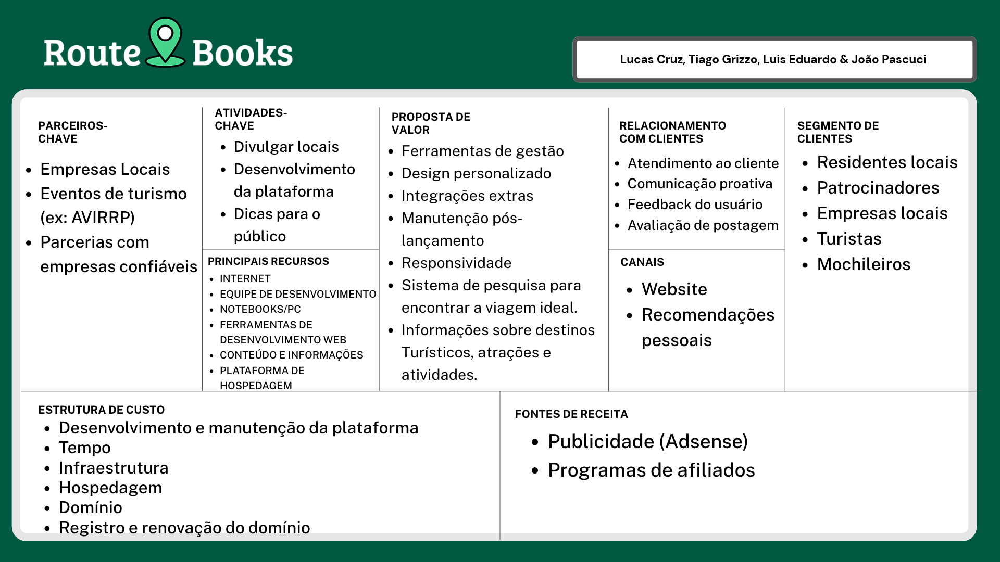

## 3.1. O que será elaborado?
### Proposta de valor:
  - Ferramentas de gestão
  - Tempo de desenvolvimento
  - Design personalizado
  - Integrações extras
  - Manutenção pós-lançamento
  - Responsividade
  - Filtros personalizados para encontrar a viagem ideal.
  - Informações detalhadas sobre destinos turísticos, atrações e atividades.

## 3.2. Como será elaborado?
### Parcerias principais:
  - Empresas locais
  - Eventos de turismo (ex: AVIRRP) 
  - Parcerias com empresas confiáveis 
### Atividades principais:
  - Dicas para o público
  - Divulgar locais (EX: PONTOS TURÍSTICOS, RESTAURANTES.)
  - Desenvolvimento da plataforma.
### Recursos principais:
  - Internet
  - Equipe de desenvolvimento
  - Notebooks/PC
  - Ferramentas de desenvolvimento web
  - Conteúdo e informações
  - PlaTaforma de hospedagem

## 3.3. Para quem será elaborado?
### Segmento de clientes
  - Residentes locais - Jaú
  - Patrocinadores
  - Empresas locais - Jaú
  - Turistas
  - Mochileiros
### Relacionamento com o cliente: 
  - Atendimento ao cliente (E-mail)
  - Comunicação proativa
  - Feedback do usuário
  - Avaliação de postagens.
### Canais: 
  - Website;
  - Redes sociais;
  - Recomendações pessoais;

## 3.4. Quanto custará?
### Estrutura de custos: 
  - Desenvolvimento e manutenção da plataforma 
  - Tempo
  - Infraestrutura
  - Hospedagem  
  - Domínio 
  - Registro e renovação do domínio
### Fontes de renda: 
  - Publicidade e Anúncios (Ads)
  - Programas de afiliados

[Voltar para o início](#inicio)

# 4. Estudo de viabilidade
### Viabilidade técnica: 
Sim, temos os equipamentos necessários fornecidos pela FATEC JAHU, computadores, internet, ferramentas web e um ambiente adequado para a realização do projeto, além dos equipamentos pessoais dos integrantes.

### Viabilidade financeira: 
É viável pelo fato que vai ser mão de obra dos integrantes do grupo, não iremos contratar ninguém de fora no momento. Ele irá nos retornar um aprendizado grande na área, evolução e oportunidades.

### Viabilidade de mercado: 
Foi feita à análise, no começo erámos uma vitrine para viagens e percebemos que já existiam muitas nesse mesmo estilo, então nos renovamos, pegamos um nicho em específico e hoje somos um blog editável/guia turístico para relatos de viajantes, empresas, que gostam/trabalham com viagens e divulgam o seu trabalho, com o intuito de mostrar o que o local oferece e suas histórias

### Viabilidade operacional: 
É viavel, pois o sistema é intuitivo e de fácil uso, a equipe é qualificada para usar e testar o sistema no dia a dia. O sistema é leve e qualquer computador suporta rodar a aplicação.

[Voltar para o início](#inicio)

# 5. Design e UX
### Paleta de cores:

| Nome | Amostras |
| :--- | :--- |
| **TONS DE VERDE PRINCIPAIS** |        |
| **TONS DE VERDE VIBRANTE (AÇÕES)** |       |
| **TONS DE VERDE FUNDOS (FEED / DARK)** |      |
| **TONS DE AZUL E DESTAQUES** |       |
| **TONS DE MARROM / NEUTROS** |    |
| **PRETO** |  |
| **BRANCO** |  |

### Tipografia: 

| **Fonte** | **Utilidade** |
|------------|---------------|
| Rubik | Para títulos |
| Nunito | Para páginas envolvendo cadastro, login e esqueci senha |
| Roboto | Para textos gerais da aplicação |

- [Rubik - Google Fonts](https://fonts.google.com/specimen/Rubik)
- [Nunito - Google Fonts](https://fonts.google.com/specimen/Nunito)
- [Roboto - Google Fonts](https://fonts.google.com/specimen/Roboto)

### Logo:
 
As figuras 3 apresentadas, são as logos do nosso projeto, uma com a escrita em preto e outra com a escrita em branco, pensada para diferentes fundos.

### Figura 3 - Logotipo

    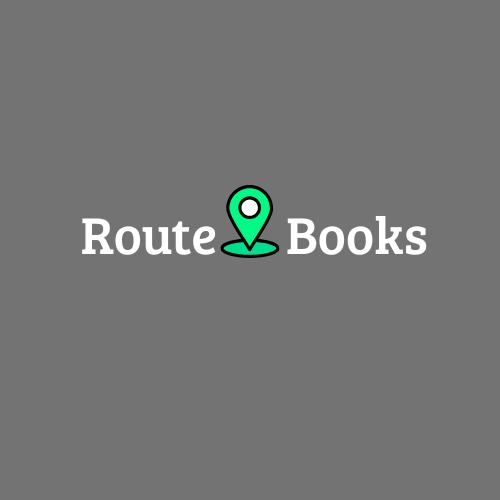
    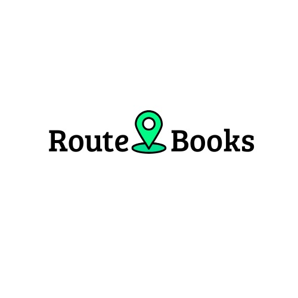

### Service Blueprint:
Abaixo, na Figura 4, apresentamos o Service Blueprint da nossa aplicação, utilizado para mapear visualmente a jornada do usuário, os processos de front-end, back-end e as interações de suporte necessárias para entregar a experiência do Route Books.

### Figura 4 - Service Blueprint

    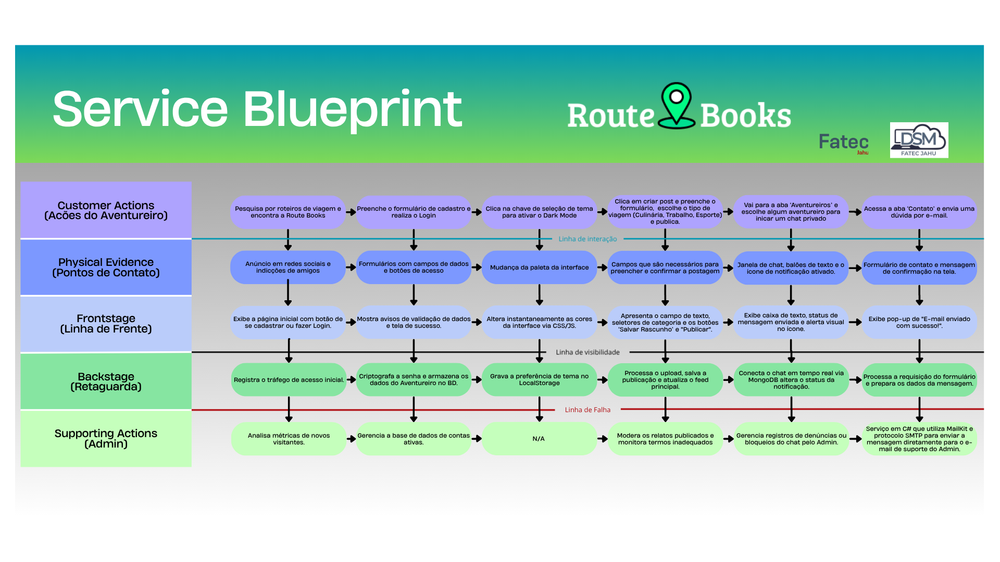

### Criação de Personas com IA:
Na Figura 5, visualizamos as personas desenvolvidas com o auxílio de ferramentas de inteligência artificial, representando os perfis reais dos nossos usuários-alvo (mochileiros, turistas e empresas locais) para guiar as decisões de UX e funcionalidades da plataforma.

### Figura 5 - Personas (IA)

| Persona 1 | Persona 2 |
| :---: | :---: |
| 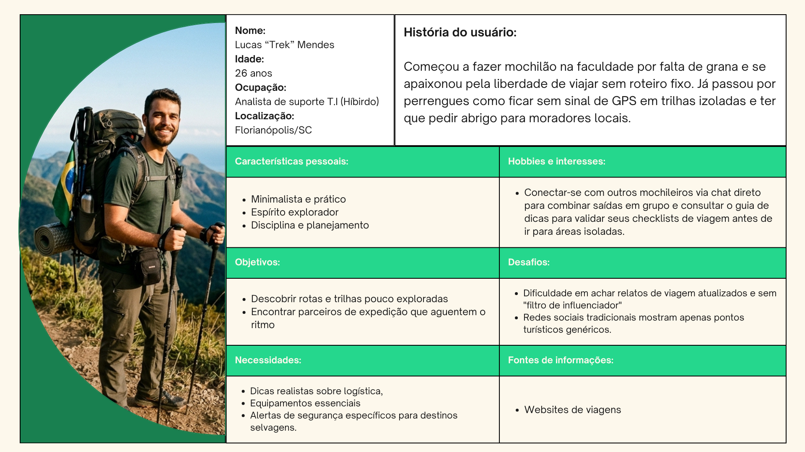 | 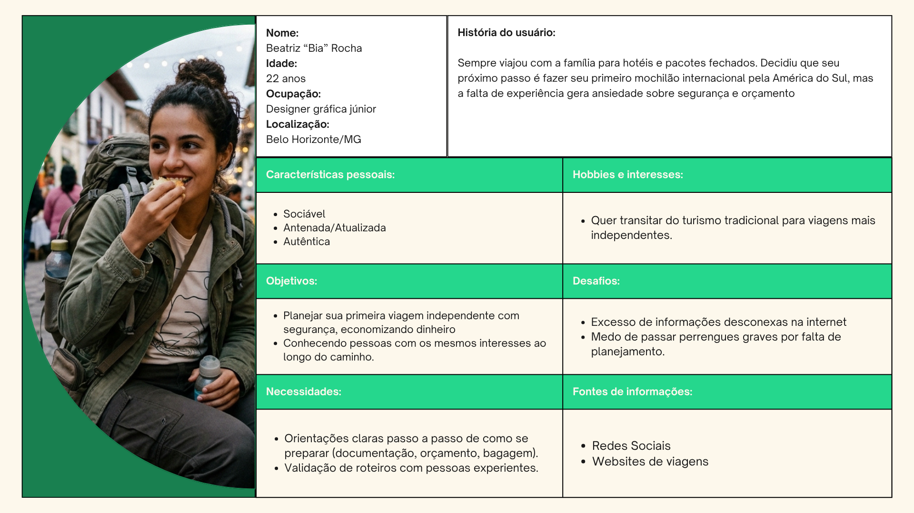 |

### Modelo de navegação:
Representação do nosso modelo de navegação, utilizada para observar como o sistema funciona, quais caminhos e processos existem dentro da aplicação.

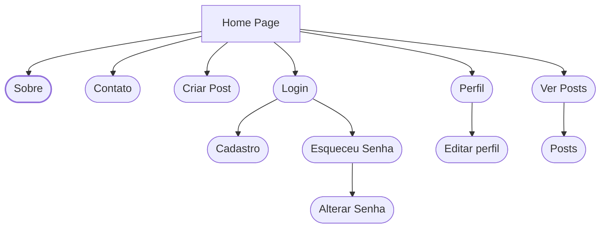

[Voltar para o início](#inicio)

# 6. Caso de uso 

CASO DE USO EXPANDIDO

BAIXO NÍVEL

CADASTRO :

Caso de uso: Cadastrar usuário no sistema
Atores: Usuário
Finalidade: Registrar usuários ao sistema para que eles possam utilizar de forma mais ampla o sistema
Visão geral: O usuário após acessar nosso site, ele poderá fazer o login, mas caso ele não tenha um registro, ele tem a oportunidade, ao clicar no link "Cadastre-se já!", de se cadastrar e informar dados básicos no sistema (Nome, e-mail, senha, país, cidade...) e ter sua conta pronta para uso.
Tipo: Primário
Referências cruzadas: RF3 - Cadastrar usuário
Ação do ator:
1. Começa com o visitante acessando o sistema
3. Ele pode já fazer o login (caso já tenha um registro), mas no caso de uma primeira visita, ele clica no link que o leva para o cadastro
4. Registra seus dados (Nome, e-mail, senha, cidade...)
5. Finaliza o registro
7. Terá sua conta pronta para ser utilizada

Resposta do sistema:
- O sistema exibe o formulário
- O Sistema valida os dados
- O sistema salva os dados do usuário
- O sistema cria sua conta

============================================================================

CRIAR POST:

Caso de uso: Criar um post sobre a sua experiência
Atores: Usuário e Admin
Finalidade: Que o usuário possa relatar a sua experiência turística e publicar em nosso site
Visão geral: O usuário após se cadastrar e realizar o login (e-mail e senha), ele está permitido a fazer uma publicação sobre turismo, basta clicar no botão "Criar Post" no canto superior direito, e você vai poder especificar em tipo (Gastrônomico, esporte, cultural...) e a categoria da sua postagem (Relato, dúvida...) e escrever o seu relato.
Tipo: Primário
Referências cruzadas: RF3 - Cadastrar usuário, RF4 - Realizar Login do usuário e RF6 - Criar Post
Ação do ator:
1. O usuário realiza o login
3. Acessa a homepage e clica no botão no canto superior direito "Criar Post"
4. Adiociona o seu relato e específica o tipo e a categoria da sua publicação
5. Clica em publicar, botão está em verde
7. Sua publicação está finalizado

Resposta do sistema:
- O sistema exibe o formulário para a criação da publicação
- Valida os dados
- O sistema salva o relato
- O sistema exibe sua publicação

============================================================================

ALTO NÍVEL

Caso de uso: Realizar cadastro  
Atores: Usuário  
Tipo: Primário  
Descrição: Permite que um novo usuário (Mochileiro, turista...) crie uma conta no sistema. O sistema solicita dados básicos (nome, email, senha, cidade, país...) e, após a validação, cria o registro no banco de dados.

Caso de uso: Fazer Login  
Atores: Usuário  
Tipo: Primário  
Descrição: Um Usuário registrado fornece suas credenciais (email e senha) para acessar o sistema. O sistema valida as credenciais; se corretas, concede acesso e você já é levado a homepage do sistema.

Caso de uso: Visualizar homepage  
Atores: Usuário e Admin  
Tipo: Primário  
Descrição: Após o login, o sistema apresenta ao Usuário a tela inicial do sistema, que exibe publicações relevantes, opções de lugares, informações sobre o que fazer e informações sobre quem somos.

Caso de uso: Criar Post  
Atores: Usuário  
Tipo: Primário  
Descrição: O usuário após se cadastrar e realizar o login, ele está permitido a fazer uma publicação sobre turismo, você pode especificar em tipo (Gastrônomico, esporte, cultural...) e a categoria da sua postagem (Relato, dúvida...).

Caso de uso: Gerenciar Perfil  
Atores: Admin e Usuário  
Tipo: Primário  
Descrição: O usuário e admin tem seus perfis, onde é possível atualizar suas informações e foto. (TERÁ MAIS FUNÇÕES, mas até o momento é isso).

Caso de uso: Excluir/Editar postagens próprias  
Atores: Usuários  
Tipo: Primário  
Descrição: O usuário pode excluir ou editar postagens dentro do site, alguns do motivos pode ser por erros ortográficos, não achou atrativo a postagem, entre outros.

Caso de uso: Denunciar contéudo  
Atores: Usuário e Admin  
Tipo: Primário  
Descrição: O usuário pode denunciar um conteúdo, por algum motivo coerente, e o admin irá avaliar se aquela postagem poderá continuar dentro do site.

Caso de uso: Buscar postagens/usuários  
Atores: Usuário e admin  
Tipo: Primário  
Descrição: O admin e o usuário podem utilizar o sistema de busca que existe dentro do sistema para facilitar o encontro de usuários e postagens existentes. 

Caso de uso: Seguir outro usuário  
Atores: Usuário  
Tipo: Primário  
Descrição: O usuário pode se conectar com outras pessoas, assim, criando networking, amizades, aprendizados e experiências.

Caso de uso: Comentar em postagens  
Atores: Usuário  
Tipo: Primário  
Descrição: O usuário pode dar a sua pequena visão sobre o assunto comentado em postagens de outros usuários.

Caso de uso: Curtir postagens  
Atores: Usuário  
Tipo: Primário  
Descrição: O usuário pode avaliar a postagem de outro usuário.

Na figura 6, é visto o modelo de caso de uso geral da nossa aplicação, que demonstra como será feito todo o processo com um visitante, para que ele vire um usuário e as funçõoes do admin. O caso de uso de baixo e alto nível está especificado.

### Figura 6 - Modelo de caso de uso 

  

    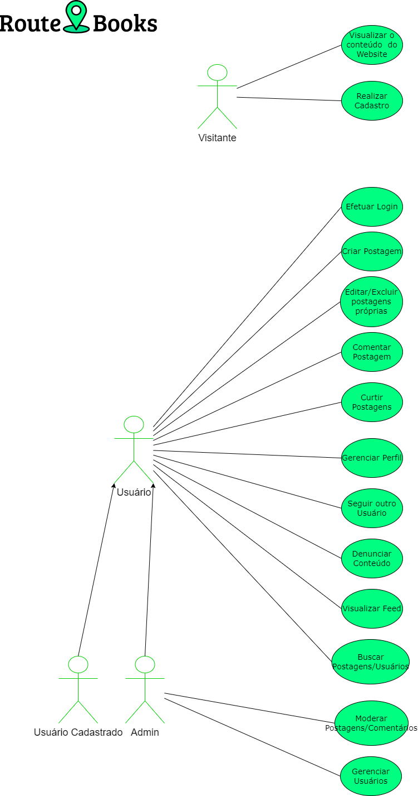
  

[Voltar para o início](#inicio)

# 7. Modelo Lógico 
Na figura 7, podemos ver o modelo lógico do nosso sistema, que mostra como os objetos se comportam e a funcionalidade deles. 

### Figura 7 - Modelo Lógico (Diagrama de classes)

    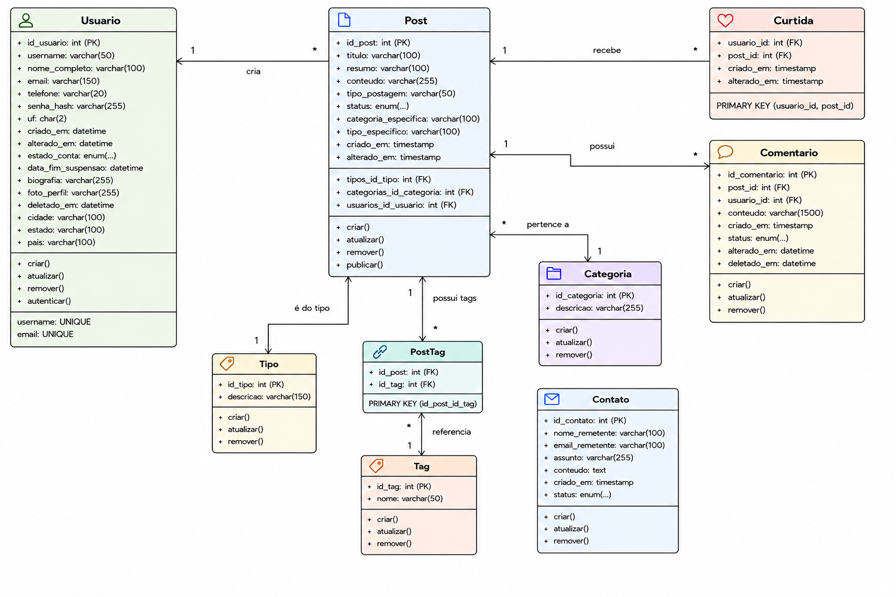
  

### Figura 8 - Modelo Físico (Modelagem do banco de dados)

Na figura 8 temos o nosso modelo físico, com relacionamento entre tabelas, chaves primárias, tabelas intermediárias, onde essas funcionalidades, funcionam dentro da aplicação 

  

    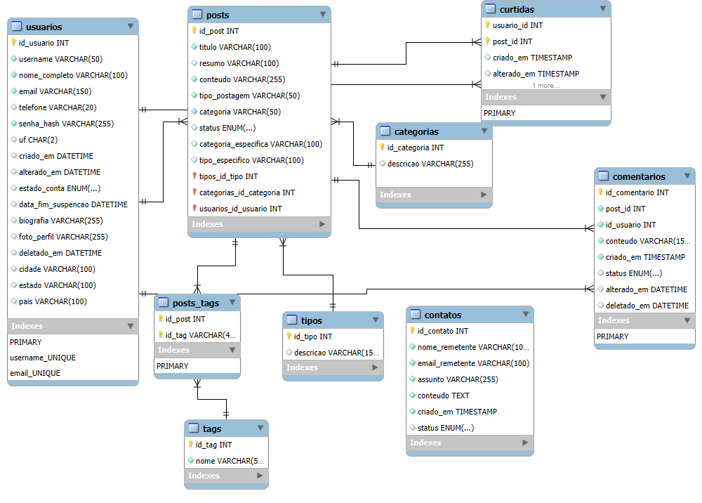
  

  

### Figura 9 - Modelo Banco de Dados NoSql (MongoDB)

Na figura 9 temos o nosso banco de dados não relacional, utilizamos MongoDB para a parte do chat entre os aventureiros da plataforma. Nela existe apenas a coleção Mensagens. 

   <table>
  <tr>
    <td valign="top">
      
    </td>
    <td valign="top">
      &nbsp;&nbsp;&nbsp;
      
    </td>
  </tr>
</table>

[Voltar para o início](#inicio) 

# 8. Protótipo
- ### Link dos protótipos com a ferramenta Figma: [Figma - Route Books](https://www.figma.com/design/8UFfrEyZOdytMzzJvd0jSB/Mockup-do-site-PI?node-id=0-1&p=f&t=6UuWB1YErd0NN2MF-0)

Na figura 10, é possível visualizar o protótipo da homepage, de como ela seria na aplicação final (Fizemos mais telas, mas coloquei apenas uma para visualização).

### Figura 10 - Protótipo da home

  

    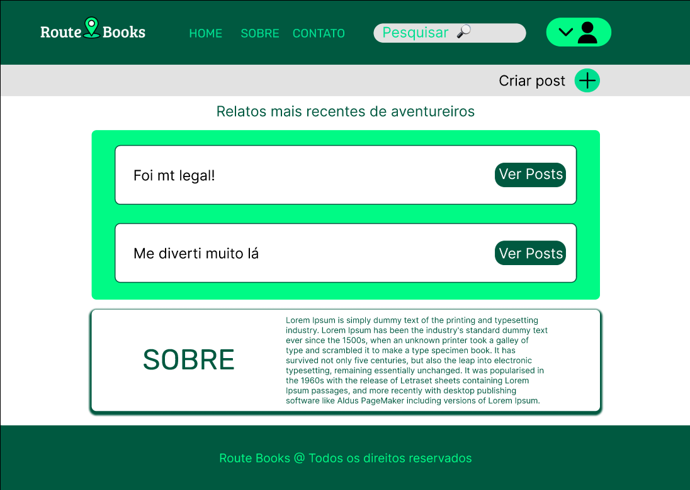
  

[Voltar para o início](#inicio)

# 9. Aplicação
- ### Link para o nosso repositório do GitHub: [Repositório - PI-ROUTE-BOOKS](https://github.com/Guilherme-RR/PI-Route-Books)

A aplicação Route Books, visa facilitar o encontro de atividades atrativas regionais, nacionais e mundiais, com as experiências relatadas por pessoas que viveram essas aventuras. Assim, tendo uma aplicação mais interativa e com a oportunidade de criar uma boa networking e ser um site informativo para ajudar todos os públicos.  

[Voltar para o início](#inicio)

# 10. Considerações finais
(SERÁ FEITO AO FINAL DOS TRABALHOS!)

[Voltar para o início](#inicio)

# 11. Referências bibliográficas
ATLASSIAN. Trello. 2025. Disponível em: [https://trello.com/](https://trello.com/)  
FIGMA, Inc. Figma: the collaborative interface design tool. 2025. Disponível em: [https://www.figma.com/](https://www.figma.com/)  
BOOTSTRAP. Disponível em: [https://getbootstrap.com/docs/5.3/getting-started/introduction/  ](https://getbootstrap.com/docs/5.3/getting-started/introduction/  ) 
FONTAWESOME. Disponível em: [https://fontawesome.com/ ](https://fontawesome.com/ ) 
EMOJIPEDIA. Diposnível em: [ https://emojipedia.org/ ]( https://emojipedia.org/ ) 
MAIKON.BIZ. Criador de personas. Disponível em: [Maikon.biz: https://maikon.biz/gerador-de-personas/](https://maikon.biz/gerador-de-personas/)

# Inspirações e referências
MOCHILEIROS. Disponível em: [ https://www.mochileiros.com/    ]( https://www.mochileiros.com/    ) 
TRIPADVISOR. Disponível em: [https://www.tripadvisor.com.br/ ](https://www.tripadvisor.com.br/ ) 
HOME TOUR. Disponível em: [https://hometour.com.br/](https://hometour.com.br/)

[Voltar para o início](#inicio)

## 🌍 Route Books

**Route Books** é um blog colaborativo, criado para viajantes e aventureiros que amam explorar o mundo. A plataforma permite que os usuários compartilhem experiências de viagem, ofereçam dicas, tirem dúvidas e montem roteiros personalizados — tudo isso em uma comunidade apaixonada por descobrir novos destinos.

## ✨ Funcionalidades

- 📖 Compartilhamento de relatos de viagem
- 💬 Seção para dicas e perguntas entre mochileiros
- 🗺️ Criação e organização de roteiros personalizados
- 🎒 Interface amigável e responsiva para fácil navegação
- 🧭 Layout pensado para valorizar o espírito aventureiro

## 📸 Imagens do Projeto

**Home Page**

**Tela dos aventureiros, o chat de bate papo (Com dark mode ativado)**

**Tela de Cadastro**

**Tela de Login**

## 🚀 Como Usar
  
1. Abra seu o Prompt de comando ou o Windows PowerShell.

2. Em um dos programas citados acima, use o comando 'cd ..' até ir para a pasta 'C:', normalmente o comando 'cd ..' precisará ser usado 2 vezes.

3. Estando na pasta 'C:' cole esse comando 'git clone https://github.com/TiagoGrizzo/PI-Route-Books', lembrando que esse comando funcioná somente caso já tenha sido baixado o git no seu computador.

4. Depois de usar o comando citado no passo de cima, entra na pasta do projeto, use o comando 'cd PI-Route-Books'.

5. Agora você deve abrir dois cmds, um na pasta "backend" e rodar dotnet restore e depois dotnet run, e um na pasta "frontend" onde você deve rodar npm run dev, assim trazendo a URL. Ou tem a opção de rodar com o comando kubectl port-forward -n routebooks svc/frontend 5173:80 na pasta RAIZ DO PROJETO e depois abrir a URL. Lembrando de ter as ferramentas necessárias para o processo! 
 
6. Pronto! Agora você pode conferir nosso projeto.